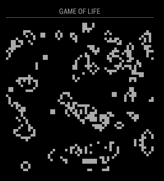
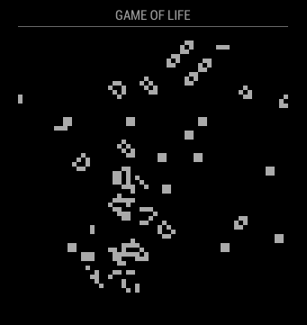

# MMM-GameOfLife

[](https://github.com/raywo/MMM-GameOfLife/actions/workflows/ci.yml)

MMM-GameOfLife is probably one of the most useful modules for the [MagicMirror²](https://github.com/MagicMirrorOrg/MagicMirror) project by [Michael Teeuw](https://github.com/MichMich). It displays a game of life with continuously developing generations.

## How it works

Conway’s Game of Life is a zero-player game. Its evolution is determined by its initial state, requiring no further input. The most interesting fact about this game is that it represents another computability model. In fact MagicMirror² could be programmed by using the Game of Life. If you want more about the Game of Life you can start [here](https://en.wikipedia.org/wiki/Conway%27s_Game_of_Life).

To show how the game evolves MMM-GameOfLife draws the game grid on a plain HTML canvas, without any additional library. Each generation is drawn as one pixel per cell and scaled up to the canvas in a single step, so drawing costs little even for many cells. Computing and drawing new generations still costs CPU power and may overheat your Raspberry Pi. By default the module computes one new generation per second; the `desiredFrameRate` property in the module’s config sets how many it computes. A setting between `5` and `10` yields nice results without using too much CPU power. While the module is hidden, for example by a module switching pages, the game pauses and continues when it is shown again.

The game will fill the playing grid with random living cells. Then it starts the evolution. Most of these configurations will result in an oscillation state after some generations. This means there will be no real movement on the screen since the same few states repeat over and over again. Whenever the module detects that a generation repeats one of the last 30 generations it restarts the game with a new set of random living cells. Patterns repeating after a longer time, such as a glider travelling around the edges of a large grid, are caught by `restartTimer`: after that time the game restarts regardless.


## Screenshots

  


## Preconditions

* MagicMirror² instance

The module has no runtime dependencies, so there is nothing to install besides the module itself.


## Installation

Just clone the module into your MagicMirror’s modules folder:

```bash
cd ~/MagicMirror/modules
git clone https://github.com/raywo/MMM-GameOfLife.git
```

## Updating

Updating is as easy as navigating to the module’s folder and pulling the latest version from GitHub:

```bash
cd ~/MagicMirror/modules/MMM-GameOfLife
git pull
```

The default branch was renamed from `master` to `main`. If you cloned the module before the rename, `git pull` fails with `no such ref was fetched`. Migrate your clone once with these commands in the module’s folder, then `git pull` works again:

```bash
git branch -m master main
git fetch origin
git branch -u origin/main main
git remote set-head origin -a
```


## Configuration

Add the module to the `modules` array in your `config/config.js`:

```js
{
  module: "MMM-GameOfLife",
  position: "middle_center",
  config: {
    desiredFrameRate: 5,
    resolution: 10
  }
},
```

You may configure the look and feel of your Game of Life instance.

| Option | Description |
| ------ | ----------- |
| `desiredFrameRate` | An integer describing how many new generations should be computed and displayed per second. <br><br>**Type:** `integer` **optional** <br>**Example:** `3` (Three new generations per second are drawn.)<br>**Default value:** `1` <br><br>**Note:** Keep in mind that a higher frame rate brings more “life” to the game but it also increases the CPU usage which may overheat your Pi! |
| `resolution` | An integer describing the size of a cell in the game’s grid. <br><br>**Type:** `integer` **optional** <br>**Example:** `5` (A cell is 5x5 pixels in size.)<br>**Default value:** `10` <br><br>**Note:** Please keep in mind that a small value for `resolution` will result in many cells which need to be computed. That can lead to high CPU usage! The smallest possible value for `resolution` is `2`. |
| `canvasWidth` | An integer describing the width in pixels of the game’s grid. <br><br>**Type:** `integer` **optional** <br>**Example:** `250` (Grid with 250px width. With `resolution` set to `5` fifty columns are generated.)<br>**Default value:** `300`<br>**Possible  Values:** values `>= 50` <br><br>**Note:** This value is an absolute measure. If you set this value too high the game’s grid may overlap other modules besides itself.|
| `canvasHeight` | An integer describing the height in pixels of the game’s grid. <br><br>**Type:** `integer` **optional** <br>**Example:** `250` (Grid with 250px height. With `resolution` set to `5` fifty rows are generated.)<br>**Default value:** `300` <br>**Possible  Values:** values `>= 50`<br><br>**Note:** This value is an absolute measure. If you set this value too high the game’s grid may overlap other modules besides itself.|
| `notAliveColorCode` | A string representing a valid html color which is used for dead cells. <br><br>**Type:** `string` **optional** <br>**Example:** `"gray"` <br>**Default value:** `#000` <br><br>**Note:** Use either a color name like `red` or `lightgray` or a hexcode like `#121212`. If you want to use a _transparent background_ set this option to `"transparent"`. |
| `aliveColorCode` | A string representing a valid html color which is used for living cells. <br><br>**Type:** `string` **optional** <br>**Example:** `"#04a515"` (Living cells are displayed in a green color.)<br>**Default value:** `#aaa` <br><br>**Note:** Use either a color name like `red` or `lightgray` or a hexcode like `#121212` |
| `oldAliveColorCode` | A string representing a valid html color which living cells take on as they age. A newborn cell has `aliveColorCode` and blends evenly into `oldAliveColorCode` over `agingGenerations` generations, so still lifes and oscillators stand out from moving patterns. <br><br>**Type:** `string` **optional** <br>**Example:** `"#137"` (Cells darken to a deep blue while they stay alive.)<br>**Default value:** `null` (Living cells keep `aliveColorCode`.) <br><br>**Note:** Use either a color name like `red` or `lightgray` or a hexcode like `#121212` |
| `agingGenerations` | An integer describing after how many generations a living cell reaches `oldAliveColorCode`. <br><br>**Type:** `integer` **optional** <br>**Example:** `10` (A cell shows `oldAliveColorCode` ten generations after its birth.)<br>**Default value:** `20` <br>**Possible  Values:** values from `1` to `100` <br><br>**Note:** Has no effect unless `oldAliveColorCode` is set. |
| `afterglow` | An integer describing for how many generations a dead cell fades out, so moving patterns leave a trail. A cell that just died shows the color it had last at half its opacity and fades out evenly. <br><br>**Type:** `integer` **optional** <br>**Example:** `4` (Dead cells fade out over four generations.)<br>**Default value:** `0` (Dead cells disappear at once.) <br>**Possible  Values:** values from `0` to `100` |
| `restartTimer` | An integer describing after how many seconds the game restarts with new random living cells, even if it is still evolving. <br><br>**Type:** `integer` **optional** <br>**Example:** `300` (The game restarts after five minutes at the latest.)<br>**Default value:** `600` <br>**Possible  Values:** values `>= 1` <br><br>**Note:** The time is counted in generations: `restartTimer` multiplied by `desiredFrameRate`. If your computer cannot keep up with `desiredFrameRate`, the game runs longer than `restartTimer` seconds. |


## Notes

This module was inspired by a coding challenge on [YouTube](http://www.youtube.com/watch?v=FWSR_7kZuYg). At first I set out to improve the code given in this challenge. After it came to life on my computer I thought it would be nice if it ran on my MagicMirror² so I made this module.

[](http://www.youtube.com/watch?v=FWSR_7kZuYg "Coding Challenge #85: The Game of Life")

The first versions used the [p5.js](https://p5js.org) library from that challenge. Later versions replaced it with a plain canvas, which needs less CPU power and no script from a CDN.


## Contributing

If you find any problems, bugs or have questions, please open a [GitHub issue](https://github.com/raywo/MMM-GameOfLife/issues) in this repository.

